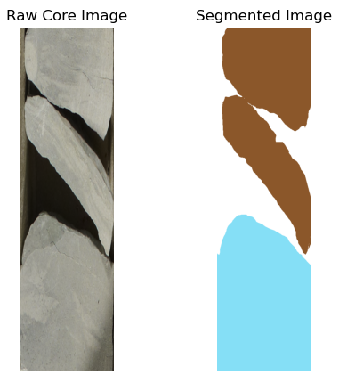
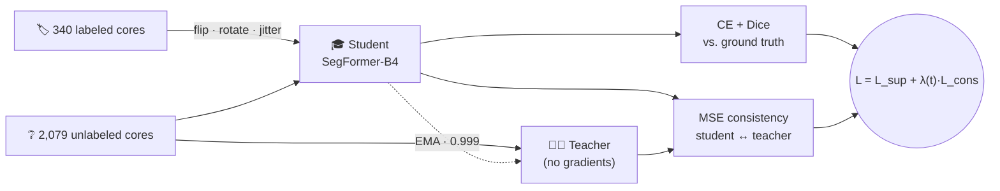
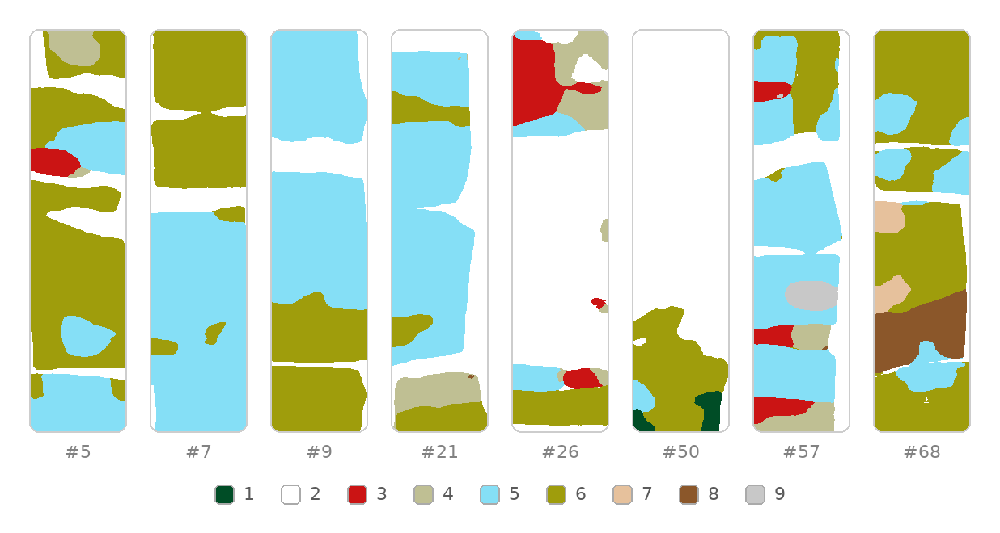

<div align="center">

# 🪨 Core Values: A Geological Quest

**Segmenting sedimentary facies in rock-core photos with a SegFormer transformer and Mean Teacher semi-supervised learning**

[](https://thinkonward.com/app/c/challenges/core-values)
[](#-results)
[](https://thinkonward.com/app/c/challenges/core-values)


</div>

---
**Timeline of the Challenge:** The challenge opened on 18 December 2024 and closed on **14 February 2025**.

This is my solution to ThinkOnward's [**Core Values: A Geological Quest**](https://thinkonward.com/app/c/challenges/core-values) challenge. I finished **#17 on the predictive leaderboard** with an image-wise macro Dice of **0.617398**.

The challenge gave us only 340 labeled core photos, plus nearly **six times as many unlabeled ones**. Most of my effort went into getting value out of those unlabeled images: first with offline pseudo-labels, then with a Mean Teacher setup, which became my best submission.

I'm publishing the notebooks exactly as they ran during the competition, rough edges included. The [lessons](#-lessons-learned) section is my honest hindsight.

## 🌍 The challenge



Geologists drill **core samples**, cylinders of rock from the subsurface. They cut each one in half and photograph it. The layers in those photos, called **sedimentary facies**, record how and where the rock formed: a high-energy river channel, a quiet seabed, a deformed shale.

The task was to label **every pixel** of a core photo with one of **9 facies classes**, so geologists don't have to trace them by hand.

| | |
|---|---|
| 🖼️ **Input** | Tall, narrow RGB core photo (≈1,200–1,750 × 300–550 px) |
| 🎯 **Output** | `uint8` mask, same size, with class IDs 1–9 |
| 🏷️ **Labeled** | 340 image/mask pairs |
| ❔ **Unlabeled** | 2,079 images |
| 🧪 **Test** | 70 public-leaderboard images, plus 81 private holdout images |
| 📏 **Metric** | Image-wise macro-averaged Dice |
| ⏱️ **Final round** | Inference on 81 images in under 30 min on an AWS `g5.12xlarge` |

<sub>*Right: Figure 1 from the [challenge page](https://thinkonward.com/app/c/challenges/core-values), a raw core photo and its segmented mask. © ThinkOnward.*</sub>

<br clear="right"/>

## 🧠 Approach

The idea behind **Mean Teacher** ([Tarvainen & Valpola, 2017](https://arxiv.org/abs/1703.01780)) is simple. The *student* learns from labeled data as usual. A *teacher*, which is a slow moving average of the student's weights, makes smoother and more stable predictions. On unlabeled images the student is asked to agree with the teacher. That turns the 2,079 unlabeled cores into an extra training signal without ever hand-labeling them.



| Component | Choice | Why |
|---|---|---|
| **Backbone** | [`nvidia/segformer-b4-finetuned-ade-512-512`](https://huggingface.co/nvidia/segformer-b4-finetuned-ade-512-512), new 9-class head | Hierarchical transformer encoder with a light MLP decoder. Strong pretrained features, and the organizers encouraged transformers. |
| **Input size** | 1200 × 300 (H × W); masks at 300 × 75 | Keeps the cores' tall shape; SegFormer predicts at ¼ resolution. |
| **Normalization** | Dataset statistics: mean `[0.658, 0.611, 0.486]`, std `[0.276, 0.287, 0.362]` | Core photos look nothing like ImageNet. |
| **Augmentation** | H-flip, ±10° rotation, brightness/contrast 0.8–1.2 (p = 0.4 each) | Cheap robustness to how the cores were photographed. |
| **Loss** | Cross-entropy + soft Dice (1 : 1) | Dice matches the metric and counters imbalance: classes 2, 5 and 6 make up ~85% of predicted pixels. |
| **Consistency** | MSE between student and teacher softmax; λ ramps 0 → 0.5 over 10 epochs | The teacher is unreliable early on, so its influence grows gradually. |
| **Optimization** | AdamW, lr 1e-4, cosine warm restarts (T₀ = 5, T_mult = 2), grad-clip 1.0, 20 epochs, batch size 4 | |
| **Inference** | Upsample logits bilinearly to the original size → argmax → `+1` | Masks must match the original image size exactly. |

## 📊 Results

| Submission | Method | Public LB Dice | Rank |
|---|---|:---:|:---:|
| [`test_predictions_self_supervised_1.npz`](submissions/test_predictions_self_supervised_1.npz) | Mean Teacher, SegFormer-B4 | **0.6174** | **#17** |

<p align="center">
  
  <br>
  <sub><i>Predicted masks for eight of the 70 test cores, all the same original size (1459 × 352 px) and shown at the same scale. Colors follow the challenge's class palette; the numbers under each mask are test sample IDs.</i></sub>
</p>

The predictions are mostly clean and blocky, which fits how facies change along a core. The rare classes are the weak spot to watch: class 9 shows up in only 3 of the 70 predicted masks. Because every class counts equally in a macro Dice score, those rare classes are likely where most of the remaining points are.

## 🔬 The experiments

| | Notebook | What it does |
|:---:|---|---|
| 1 | [`01_segformer_b0_prototype`](notebooks/01_segformer_b0_prototype.ipynb) | First end-to-end sketch with a small SegFormer-B0, run locally on CPU. |
| 2 | [`02_supervised_pseudo_labeling`](notebooks/02_supervised_pseudo_labeling.ipynb) | **Self-training.** Train B4 on the labeled data, pseudo-label the unlabeled set (keeping pixels with ≥ 70% confidence), then fine-tune on those pseudo-labels. |
| ⭐ | [`03_mean_teacher_semi_supervised`](notebooks/03_mean_teacher_semi_supervised.ipynb) | **Mean Teacher.** Learns from labeled and unlabeled data together. This produced the scored submission. |
| ➕ | [`src/mean_teacher.py`](src/mean_teacher.py) | A later rewrite: AMP, KL consistency against sharpened teacher targets, and every unlabeled image seen each epoch. Not used for the leaderboard score. |

## 💡 Lessons learned

Reading the code again later, a few things stand out:

> [!WARNING]
> **Label indexing.** As saved, `create_label_mask` produces classes 1–9, but the model has 9 outputs (0–8). To re-run training, use `create_label_mask(...) - 1`. Inference already adds the `+1` back.

- **Most of the unlabeled data went unused.** `zip()` stopped at the 85 labeled batches, and the unlabeled loader wasn't shuffled. So each epoch saw the *same 85* of the 2,079 unlabeled images. There's real headroom here.
- **The student and teacher saw the same view.** Mean Teacher works much better when the teacher gets a weak augmentation and the student a strong one.
- **There was no validation split,** so I picked models by leaderboard score. A held-out set from the 340 labeled images would have been more reliable.
- `src/mean_teacher.py` fixes the first two problems, but it was never run end-to-end. It needs `import numpy as np`, and its `OneCycleLR` step count needs to be `num_epochs * len(unlabeled_loader)`.

**If I picked this up again**, I'd add strong augmentations on the unlabeled branch, use the EMA teacher for inference, add flip test-time augmentation, and predict on tiles at full resolution instead of squeezing every core to 1200 × 300.

## 🚀 Running it

1. **Get the data** from the challenge's *Data* tab (registration required; it isn't redistributed here). The notebooks were run on Kaggle and expect this layout:
   ```
   /kaggle/input/core-segmentations/
   ├── train/train/        # <id>_img.png + <id>_lab.png  (340 pairs)
   ├── train_unlabeled/    # 2,079 images
   └── test/test/          # 70 images
   ```
   To run elsewhere, edit `labeled_data_dir`, `unlabeled_data_dir` and `test_data_dir`.
2. **Install dependencies.** Python 3.10+ and a CUDA GPU are strongly recommended.
   ```bash
   pip install -r requirements.txt
   ```
3. **Run** [`notebooks/03_mean_teacher_semi_supervised.ipynb`](notebooks/03_mean_teacher_semi_supervised.ipynb) through *Inference on Test Data*. The output is an `.npz` with one `<id>_lab` `uint8` mask per test image.

<details>
<summary><b>📁 Repository layout</b></summary>

```
.
├── assets/                  # figures used in this README
├── notebooks/
│   ├── 01_segformer_b0_prototype.ipynb
│   ├── 02_supervised_pseudo_labeling.ipynb
│   └── 03_mean_teacher_semi_supervised.ipynb   ⭐ scored submission
├── src/
│   └── mean_teacher.py      # revised Mean Teacher training loop
├── submissions/
│   └── test_predictions_self_supervised_1.npz  # 70 test masks · Dice 0.6174
├── requirements.txt
└── LICENSE
```

</details>

<details>
<summary><b>🎨 Class ↔ color mapping</b></summary>

| Class | 1 | 2 | 3 | 4 | 5 | 6 | 7 | 8 | 9 |
|---|---|---|---|---|---|---|---|---|---|
| RGB | (0,77,38) | (255,255,255) | (203,20,20) | (191,191,147) | (133,223,246) | (159,157,12) | (230,193,156) | (139,87,42) | (200,200,200) |

</details>

## 🙏 Acknowledgements

- [**ThinkOnward**](https://thinkonward.com) for hosting the challenge and providing the data, starter kit and Figure 1.
- Xie et al., [*SegFormer*](https://arxiv.org/abs/2105.15203) (NeurIPS 2021), and Tarvainen & Valpola, [*Mean Teachers*](https://arxiv.org/abs/1703.01780) (NeurIPS 2017).
- 🤗 Hugging Face for the pretrained SegFormer weights.

## 📄 License

The code in this repository is released under the [MIT License](LICENSE). The challenge data and Figure 1 belong to ThinkOnward and are not covered by this license.
